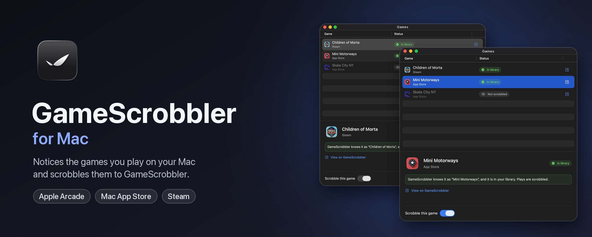

# GameScrobbler for Mac

A macOS menu bar app that notices when you play a game on your Mac and
scrobbles the play session to [GameScrobbler](https://gamescrobbler.com)
through its public API.

- **Apple Arcade / Mac App Store games:** detected from the app's App Store receipt and its "games" category.
- **Steam games:** detected from the running game's install folder.
- **GOG and Epic:** planned.

Work in progress; this is also my first Swift project.

## Install

Needs macOS 14 Sonoma or later, on Apple silicon or Intel.

1. Download the `.dmg` from the [latest release](https://github.com/mehrad77/gamescrobller-mac/releases/latest),
   open it, and drag **GameScrobbler** to **Applications**.
2. Open GameScrobbler from Applications. The app is not signed with an Apple
   Developer ID, so macOS blocks the first launch. Allow it once, either way:
   - in **System Settings → Privacy & Security**, click **Open Anyway** next to
     the message about GameScrobbler;
   - or run this in Terminal:

     ```bash
     xattr -dr com.apple.quarantine /Applications/GameScrobbler.app
     ```

3. Click the GameScrobbler icon in the menu bar and open **Settings…**. Paste a
   personal access token, created on gamescrobbler.com in your developer
   settings with the `activity:write` and `library:write` scopes.
4. Turn on **Send plays to GameScrobbler**.

## Layout

```text
App/                           the menu bar app (Xcode only)
  GameScrobbler.xcodeproj      Xcode project; links ScrobblerCore from Core/
  GameScrobbler/               the app's SwiftUI code
Core/                          a Swift package (Xcode, or swift build/test in Terminal)
  Package.swift                SwiftPM manifest for the core library and tools
  Sources/
    ScrobblerCore/             all logic (detection, API client, scrobbler), a library
    gs-detect/                 command-line debug tool for the detection code
  Tests/
    ScrobblerCoreTests/        Swift Testing tests for ScrobblerCore
```

The app is a thin SwiftUI shell; everything it does lives in `Core/`, so the
logic builds and tests without Xcode or any UI.

## Build and run

You need Xcode 27 or later (the project uses its text-based format; open Xcode once to finish its setup).

- **App:** open `App/GameScrobbler.xcodeproj` in Xcode and press Run (`Cmd+R`). The app lives in the menu bar (a game controller icon); it has no Dock icon or window.
- **From the terminal:**

  ```bash
  xcodebuild -project App/GameScrobbler.xcodeproj -scheme GameScrobbler -derivedDataPath .build/xcode build
  ```

  ```bash
  open .build/xcode/Build/Products/Debug/GameScrobbler.app
  ```

- **Tests** (from the `Core/` folder):

  ```bash
  cd Core && swift test
  ```

- **Debug tool** (from `Core/`): `swift run gs-detect` lists the games the app recognises, and `swift run gs-detect --watch` prints games as they start and stop.

## License

GPL-3.0, see [LICENSE](LICENSE).
